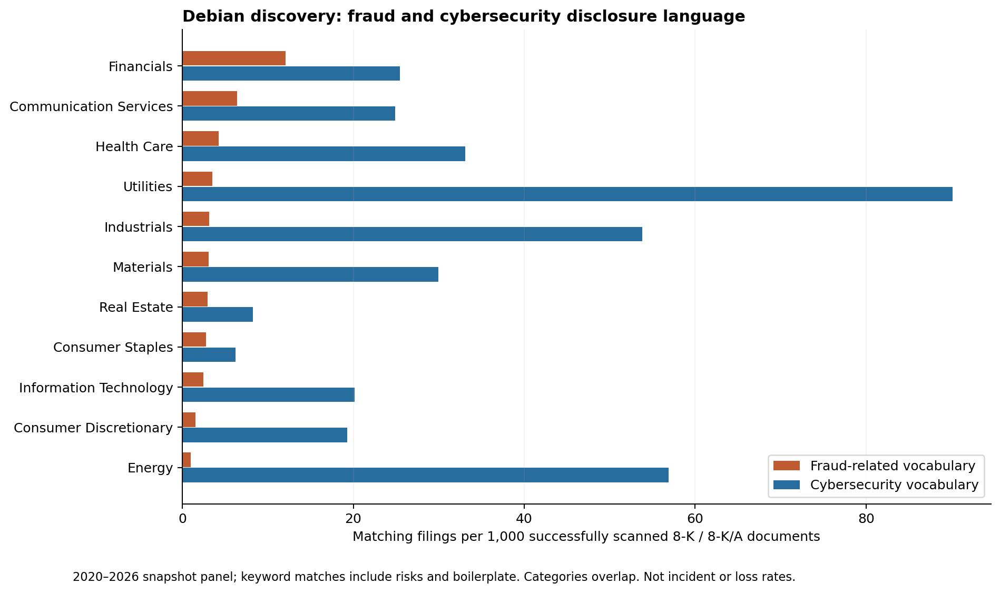
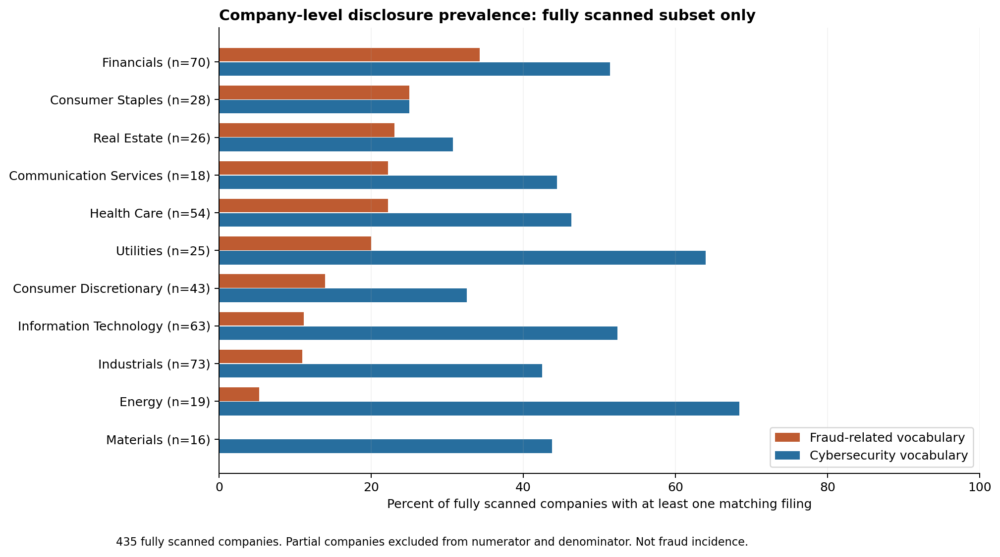
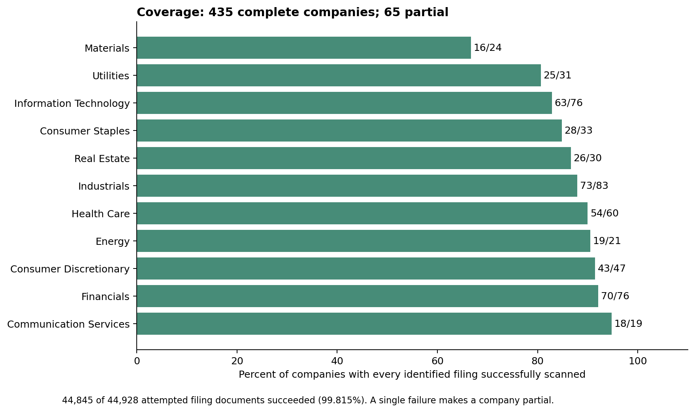

# Debian discovery analysis — November 21, 2026

[Follow-up: Fifth Third match dates and the documented July 2024 regulatory resolutions](FIFTH_THIRD.md).

**You have a usable proof of concept, not a fraud-loss estimate.** The scanner
successfully searched 44,845 primary 8-K/8-K/A documents across all 11 sectors.
The strongest finding is that repeated corporate risk language can dominate
keyword-based comparisons. Event-specific disclosures can contain financial
amounts, but extracting those requires more context and classification.

## 1. What actually ran

Source: `results/2026-11-21_003915_094872`, uploaded in Git commit `123bc20`
with message “Add Debian discovery scan results.” The repository version preceding upload was
`6695fc3`; the scan did not record its own Git revision. The source files have been preserved unchanged; checksums are in
[metrics.json](metrics.json).

| Measure | Result |
|---|---:|
| Companies in fixed snapshot | 500 |
| Fully scanned companies | 435 (87.0%) |
| Partially scanned companies | 65 |
| Attempted primary filing documents | 44,928 |
| Successfully scanned documents | 44,845 (99.815%) |
| Failed downloads | 83 |
| Fraud-vocabulary-positive filings | 209 |
| Cyber-vocabulary-positive filings | 1,508 |
| Filings matching both vocabularies | 128 |
| Filings matching either vocabulary | 1,589 |
| Saved candidate passages | 1,817 |
| Corrected declared Item 1.05 filings | 21, from 14 companies |

The period requested was January 1, 2020–November 21, 2026. Actual successfully
scanned filing dates run January 2, 2020–November 20, 2026. There are 43,948 8-Ks
and 897 8-K amendments among successful scans. No LLM was used.

All 500 companies reached metadata collection. The 65 partial companies do not
mean 65 missing companies: each had one or more document failures. The 83 failures
were 31 HTTP 504s, 25 HTTP 502s, 14 SSL handshake timeouts, and 13 network-unreachable
errors. This is strong filing coverage with incomplete company-level coverage.

## 2. Critical correction: Item 1.05, not Item 1.06

The earlier guidance and code were wrong about the cybersecurity item number.
The SEC's [official rule announcement](https://www.sec.gov/newsroom/press-releases/2023-139)
specifies **Item 1.05 of Form 8-K** for material cybersecurity incident disclosures.
Regulation S-K Item 106 is the separate annual cybersecurity disclosure rule.

The raw `item_106` column is therefore invalid as an incident-item measure, and
the original generated report's zero should not be presented as a substantive
finding. Re-reading the saved `declared_items` metadata recovers **21 Item 1.05
filings from 14 companies** without rerunning the scan. There are 13 initial
8-Ks and 8 amendments in that subset; these are not 21 distinct incidents.

Corrected subset by sector: Health Care 10 filings / 6 companies; Information
Technology 4 / 3; Financials 3 / 2; Materials 2 / 1; Communication Services 1 / 1;
Energy 1 / 1. Other sectors have no observed declared Item 1.05 filings in this
retrieved subset—not proof that no cybersecurity incidents occurred.

The source results are unchanged. The collector, tests, and README have been
corrected for future runs. [Corrected filing list](item_1_05_filings.csv).

## 3. Sector comparisons

Counts below include successful filings from both complete and partial companies.
The per-1,000-filing measure controls for different filing volumes, but does not
remove boilerplate, event repetition, or differences in disclosure practice.

| Sector | Complete companies | Scanned filings | Fraud-word filings | Fraud / 1,000 | Cyber-word filings | Cyber / 1,000 | Item 1.05 filings |
|---|---:|---:|---:|---:|---:|---:|---:|
| Communication Services | 18/19 | 2649 | 17 | 6.42 | 66 | 24.91 | 1 |
| Consumer Discretionary | 43/47 | 3885 | 6 | 1.54 | 75 | 19.30 | 0 |
| Consumer Staples | 28/33 | 2906 | 8 | 2.75 | 18 | 6.19 | 0 |
| Energy | 19/21 | 1985 | 2 | 1.01 | 113 | 56.93 | 1 |
| Financials | 70/76 | 7709 | 93 | 12.06 | 196 | 25.43 | 3 |
| Health Care | 54/60 | 4954 | 21 | 4.24 | 164 | 33.10 | 10 |
| Industrials | 73/83 | 6408 | 20 | 3.12 | 345 | 53.84 | 0 |
| Information Technology | 63/76 | 5665 | 14 | 2.47 | 114 | 20.12 | 4 |
| Materials | 16/24 | 1937 | 6 | 3.10 | 58 | 29.94 | 2 |
| Real Estate | 26/30 | 3040 | 9 | 2.96 | 25 | 8.22 | 0 |
| Utilities | 25/31 | 3707 | 13 | 3.51 | 334 | 90.10 | 0 |

**Financials leads the observed fraud-vocabulary rate:** 93 filings, or 12.06 per
1,000 successfully scanned filings. Communication Services follows at 6.42 and
Health Care at 4.24. This establishes where the search vocabulary appears most
frequently, not which sector suffers the most fraud.

**Utilities leads the cyber-vocabulary rate:** 334 filings, or 90.10 per 1,000.
Energy is next at 56.93 and Industrials at 53.84. This is largely a risk-language
signal until event review proves otherwise.

Company-level rates reduce repeated-filing effects. Among fully scanned Financials
companies, 24 of 70 (34.3%) have at least one fraud-vocabulary match and 36 of 70
(51.4%) have a cyber-vocabulary match. These are unreviewed disclosure rates.

Materials has zero fraud-positive companies in its fully scanned subset, but six
fraud-positive filings among successful scans overall. Those positives belong to
partial companies excluded from the complete-company denominator. Neither result
means the Materials sector has no fraud. This illustrates why coverage matters.

## 4. What is driving the apparent differences?

### Repeated language strongly affects the counts

Fifth Third accounts for **44 of Financials' 93 fraud-positive filings (47.3%)**.
At least **37 distinct Fifth Third filings** contain the exact phrase:

> losses related to fraud, theft, misappropriation or violence

In the inspected context this phrase is part of forward-looking risk language,
not a report of 37 separate fraud events. Excluding Fifth Third's 185 scanned
filings reduces the remaining Financials fraud-word rate from **12.06 to 6.51
per 1,000**—close to Communication Services' 6.42. This is a sensitivity check,
not a recommendation to delete Fifth Third from the research.

FirstEnergy contributes 91 cyber-positive filings and Xcel contributes 80.
Together they account for **171 of Utilities' 334 matches (51.2%)**. Inspected
FirstEnergy excerpts describe risks of cyberattacks alongside other business
risks. The counts cannot be read as counts of attacks.

### Dollar amounts require careful attribution

Seven purposively selected examples were reviewed to illustrate interpretation;
this is **not a random sample or an estimated false-positive rate**.

| Example | What the disclosure supports | What it does not support |
|---|---|---|
| Fifth Third | Repeated forward-looking fraud-risk language | A new incident for every matching filing |
| FirstEnergy | Repeated cybersecurity-risk language in inspected excerpts | An attack for each keyword match |
| Adobe / Figma, September 2022 | A $40 million indemnification escrow limit with fraud exceptions | A $40 million fraud loss |
| Aflac, June 2025 | An actual unauthorized-access incident, reported under Item 8.01 | Proven realized fraud because identity-theft protection was offered |
| Alexandria, August 2024 | A fraud-in-the-inducement allegation and $161.5 million of described project expenditures | An adjudicated $161.5 million fraud loss |
| Insulet, December 2024 | A $452 million trade-secret misappropriation jury award, with collection uncertainty | A realized company fraud loss or $452 million cash received |
| Coinbase, May 2025 | An actual cyber incident with a preliminary remediation/reimbursement expense estimate | A final realized loss, criminal revenue, or an industry total |

Quotes, SEC links, and review rationale are in [reviewed_examples.csv](reviewed_examples.csv).

## 5. A concrete financial-impact lead: Coinbase

The [May 15, 2025 Coinbase 8-K](https://www.sec.gov/Archives/edgar/data/1679788/000167978825000094/coin-20250514.htm)
was retrieved directly from the SEC during this analysis. It states:

> the Company has preliminarily estimated expenses to be within the range of approximately $180 million to $400 million relating to remediation costs and voluntary customer reimbursements relating to this Incident

The filing says further losses, indemnification claims, and potential recoveries
could meaningfully change the estimate. It also describes improper internal data
access, fraud-monitoring protections, and the risk of social-engineering attempts.

This provides a real lead for research on the **business costs of fraud-related
cyber events**. It is an estimated expense range, not confirmed criminal proceeds
or a clean realized fraud-loss figure. Reimbursements and remediation should
remain distinguishable where the company separates them.

Importantly, the expense paragraph is outside the saved short keyword excerpts.
Searching whole documents works, but saving only short windows can omit the
financial-impact information needed for the next stage.

## 6. What worked and what did not

**Worked:** broad discovery across 500 companies; 99.815% filing-download success;
source-linked passages; separate fraud/cyber vocabulary; recovery of formal
Item 1.05 records from saved metadata; real financial-impact leads in source text.

**Needs correction/refinement:** the incorrect item number (now corrected);
repeated risk language; mergers/contracts and intellectual-property cases mixed
with narrow fraud; cross-filing updates/amendments counted repeatedly; short
excerpts missing amounts; 83 download failures; no exhibit coverage; and no
manual event/amount validation of the full positive set.

## 7. Recommended research direction

A defensible fraud-focused question is:

> **When S&P 500 companies disclose fraud-related events, how often do they quantify the financial impact, and how does disclosure specificity differ across sectors?**

Start with the 209 fraud-vocabulary-positive filings. Classify each as general
risk, contract language, allegation, confirmed event, prevention/service discussion,
or unrelated match. Separate the company's role: victim, alleged perpetrator,
service provider, or regulatory exposure. Keep cybersecurity as a separate axis;
include it in fraud analysis only where the disclosure supports the connection.

Use the 21 declared Item 1.05 filings as a cybersecurity comparison set, not a
fraud set. Include actual event disclosures under Item 8.01, such as Aflac's,
so a formal-item-only search does not miss events.

For event-specific cases, review enough source text to record amount, currency,
period, estimate versus realized amount, company attribution, and category:
loss, provision, reimbursement, remediation, fine, recovery, or damages award.
Deduplicate amendments/updates into event histories before comparing sectors.
Follow financial-impact leads into later 10-K/10-Q notes where appropriate.

Practical sequence: review a stratified 30–50 positive-filings pilot, refine the
labels, then classify the remaining positive set. An LLM may help after those
labels are stable, but its output must retain quotes and be checked on the manual
sample. Retry the 83 failed URLs rather than repeating the entire 44,845-document
successful collection. No model calls were made for this analysis.

## 8. What you can say in a presentation now

> I built an 8-K disclosure scanner and applied it to a fixed 500-company panel.
> It searched 44,845 documents successfully and identified 209 fraud-related and
> 1,508 cyber-related keyword-positive filings. The important discovery was that
> repeated risk language substantially affects sector comparisons. After correcting
> the item number, the saved metadata identified 21 Item 1.05 disclosures from
> 14 companies. A source review also found a preliminary $180–$400 million
> remediation/reimbursement estimate in Coinbase's filing. My next stage is to
> classify event-specific disclosures and evaluate how often financial impacts
> are quantified, rather than treating keyword counts as fraud incidents.

This is a credible progress/POC presentation. It does **not** establish that fraud
is the world's second-largest revenue generator, that all cyberattacks are fraud,
that sector differences are statistically significant, or that AI caused them.

## 9. Limitations and reproducibility

The panel is a third-party snapshot retrieved November 20, 2026—not verified
historical S&P 500 membership. The study covers primary 8-Ks, not all corporate
fraud, consumer complaints, exhibits, or full annual financial statements.
2026 is incomplete. Item 1.05 reporting began in December 2023; raw pre/post counts
would confound rule changes with underlying events. Partial companies and different
filing frequencies also affect comparisons. No causal or significance claim is made.

The Debian label records where collection ran; the operating system itself is
not an explanatory variable. Code version, retrieval date, coverage and source
content matter more.

Run `python3 analyze_results.py` to regenerate metrics, corrected sector tables,
and graphs from the uploaded CSVs (requires matplotlib). Original data are not
modified. The seven illustrative reviews and this written interpretation are
human-authored; they are not generated by a model or a random-sample classifier.
Graphs are also available as SVG for presentation/export.
